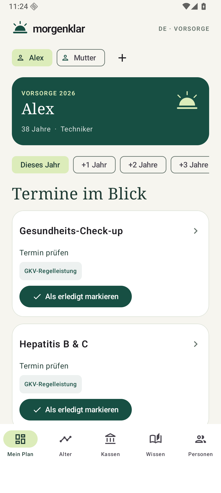
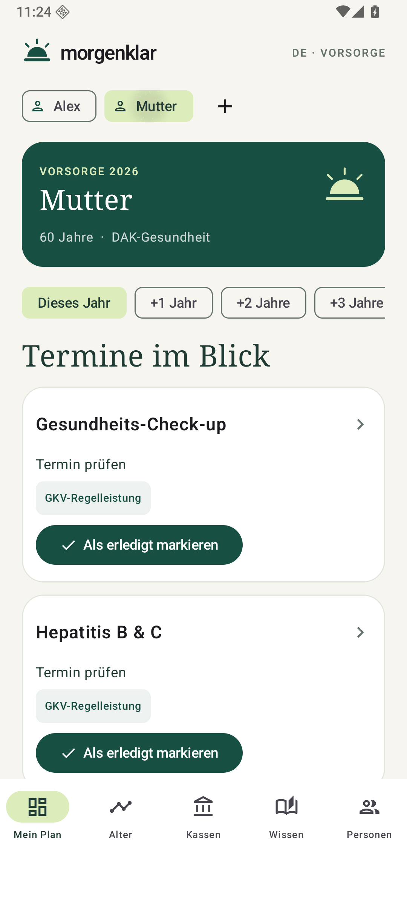
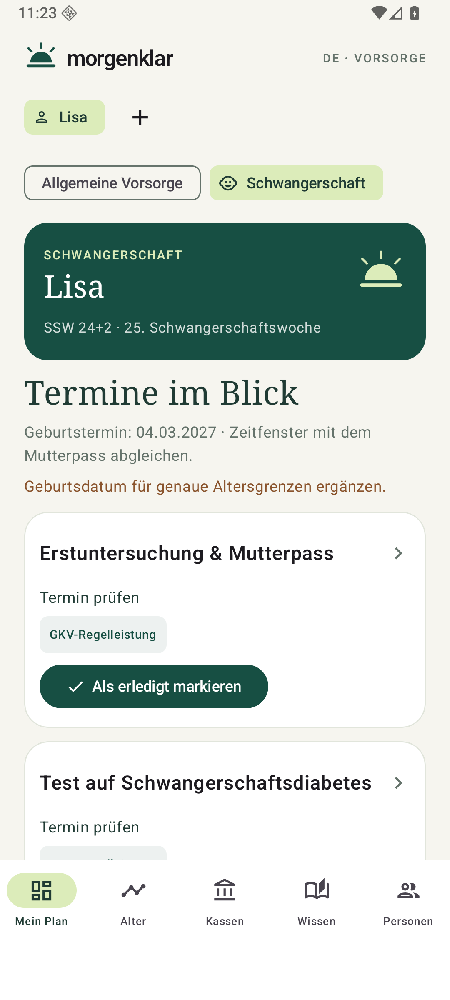
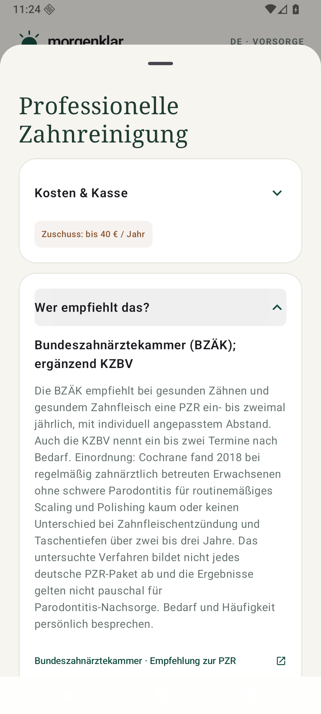
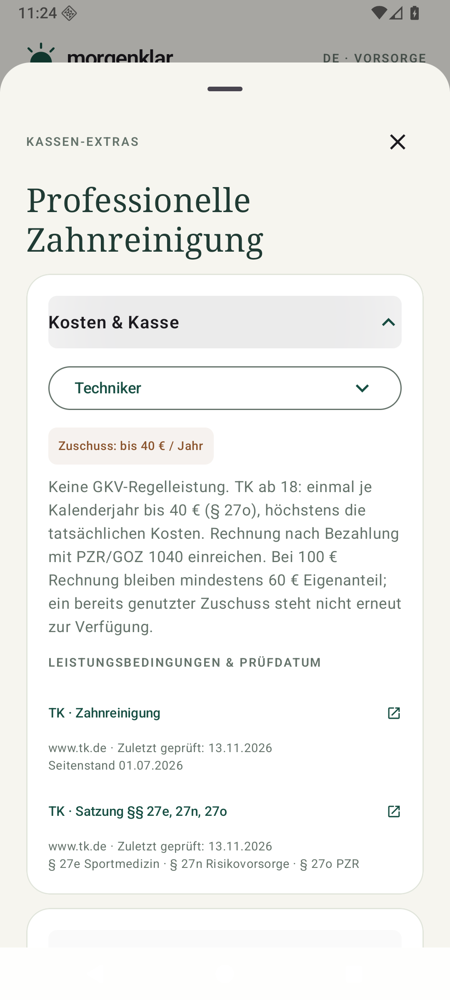

# Morgenklar — dein Vorsorgekompass

Native Android-App in Kotlin / Jetpack Compose. Lokale Profile für dich und Angehörige, Gesundheitsfragen, altersbezogene Vorsorge, Untersuchungshistorie und eine Vorschau um ein bis drei Jahre. Schwerpunkt Deutschland und Erwachsene ab 30; Altersatlas von 0 bis 110.

**Version 0.1.1 · Android 9 oder neuer · Recherchestand 13. November 2026**

[APK 0.1.1 herunterladen](https://github.com/aPeterHeise/morgenklar/releases/download/v0.1.1/morgenklar-0.1.1.apk) · [Release und Prüfsumme](https://github.com/aPeterHeise/morgenklar/releases/tag/v0.1.1) · [Ausführliche Recherche](research/RECHERCHE.md) · [Altersatlas](research/ALTERSATLAS.md)

## Installieren

Version 0.1.1 ist mit demselben Schlüssel wie 0.1.0 signiert und kann als Update installiert werden. Die vorhandenen Profile bleiben dabei erhalten; eine Deinstallation ist nicht erforderlich.

1. `morgenklar-0.1.1.apk` aus dem [GitHub-Release v0.1.1](https://github.com/aPeterHeise/morgenklar/releases/tag/v0.1.1) auf dem Android-Gerät herunterladen und öffnen.
2. Falls Android nachfragt, die Installation für den verwendeten Browser oder Dateimanager erlauben.
3. Die App öffnen und ein Profil anlegen. Krankenkasse und Gesundheitsfragen sind freiwillig. Weitere Personen lassen sich anschließend hinzufügen.

Die APK ist eine mit dem lokalen Android-Debugschlüssel signierte Vorschau, keine Play-Store-Veröffentlichung. Die erste Nutzung startet mit einem leeren Profilformular; Demo-Personen werden nicht mitgeliefert. Im Release liegt außerdem `SHA256-0.1.1.txt` zur Integritätsprüfung. Selbst gebaute APKs nutzen den jeweiligen lokalen Signierschlüssel und können deshalb möglicherweise nicht als Update über die veröffentlichte Vorschau installiert werden. Eine Deinstallation löscht die lokalen Profile.

Für die Verteilung über Firebase App Distribution ist ein [GitHub-Release-Workflow](docs/RELEASING.md) vorbereitet. Die einmalige Cloud-Berechtigung muss vor dem automatischen Betrieb noch freigegeben und eingerichtet werden.

## Änderungen in 0.1.1

- Leistungsbedingungen und ein explizites Prüfdatum je nachgeprüfter Quelle direkt in Plan, Altersübersicht und Kassenvergleich; Richtlinien, Satzungen und Bonusbedingungen sind getrennt von medizinischen Empfehlungen zugeordnet.
- „Wer empfiehlt das?“ bei allen 63 Angeboten: benannte Herausgeber, Art der Grundlage und verlinkte Belege. Ein G-BA-Versorgungsangebot wird nicht als individuelle ärztliche Empfehlung ausgegeben.
- PZR: TK maximal 40 € einmal je Kalenderjahr ab 18, DAK maximal 60 € je Kalenderjahr; mögliche Eigenanteile deutlich sichtbar. DAK-Antragsfrist 31.03. des Folgejahres ergänzt. BARMER-Bonus bleibt ein geteiltes, von Punkten abhängiges Budget.
- DAK-Hautscreening vor 35 nur bei Risikofaktoren; Schwangerschaftsextras nach den konkreten Satzungsbedingungen mit Untersuchungsanlass, Belegen und ggf. gemeinsamer Budgetgrenze.
- COVID-19 korrigiert: Standardimpfung ab 75 laut STIKO-Änderung Juli 2026 und Schutzimpfungs-Richtlinie seit 29.10.2026; darunter nur bei entsprechender Indikation. Die Terminplanung berücksichtigt den Sechsmonatsabstand zur letzten dokumentierten Impfung; Infektionen erfordern individuelle Abstimmung.
- Die Empfehlung zur PZR stammt von BZÄK/KZBV; die eingeschränkte Übertragbarkeit der Cochrane-Studien zu Scaling/Polishing wird daneben erläutert.

## Enthalten

- Beliebig viele lokale Profile mit optionaler Krankenkasse: TK, BARMER, DAK oder ohne Angabe.
- Geburtsdatum oder ungefähres Erwachsenenalter, anpassbare relevante Anatomie.
- Freiwillige Gesundheitsfragen: Rauchstatus, Rauchjahre, Packungsjahre, Rauchstopp, Erkrankungen/Risiken, familiäre Belastung und individueller Nachsorgeplan.
- Schwangerschaftsprofil mit optionalem Geburtstermin, Wochenplan, Ultraschall-/Laborfenstern, Impfberatung und getrenntem Kassenvergleich. Jede Schwangerschaft hat eine eigene Untersuchungshistorie.
- Jahresplan und Vorschau; fehlende Historie heißt „Termin prüfen“, nicht automatisch „fällig“.
- Tatsächliche Untersuchungstermine eintragen und entfernen. Bei Impfserien nur die vollständige Serie eintragen. Keine medizinischen Befundwerte.
- Darmtest und Darmspiegelung als Alternativen, mit Pausenzeiten nach regulärer Vorsorgekoloskopie.
- Kassenvergleich mit Prozenten, Höchstbeträgen, Bedingungen, gemeinsamem Bonusbudget und Beispielrechnung zur PZR.
- Evidenzeinordnung zu Longevity, Vitaminen und Hormonen sowie Ausblick auf Österreich und England.
- 63 redaktionelle Angebote und 70 Quellen, Stand 13.11.2026. Angekündigte Änderungen bleiben als solche markiert.

## Einblicke

Tatsächliche Android-Ansichten mit fiktiven Testprofilen:

<p>
  
  
  
  
  
</p>

## Medizinische Quellen und Leistungsgrundlagen

Die Inhalte wurden aus öffentlich zugänglichen Richtlinien, Empfehlungen und Leistungsbeschreibungen zusammengestellt. **Eine Kassenleistung ist nicht automatisch eine medizinische Empfehlung oder Pflicht.** Die App unterscheidet gesetzliche Ansprüche, bedingte Kassenextras und ergänzende Informationen zur Forschung. „Zuletzt geprüft“ ist ein redaktionelles Abrufdatum, kein Gültigkeitsversprechen. Der ältere Veröffentlichungs- oder Versionsstand steht separat; nicht erneut geprüfte Hintergrundquellen sind entsprechend bezeichnet. Die Quellenangaben machen die Grundlage überprüfbar; sie bedeuten keine Zertifizierung, Kooperation oder Freigabe durch die genannten Institutionen. Eine unabhängige ärztliche Prüfung der App steht aus.

### Vorsorge, Früherkennung und Schwangerschaft

| Themen in der App | Verwendete Originalquellen |
|---|---|
| Altersgrenzen, Hautscreening, allgemeine Früherkennung | [G-BA: Früherkennungsuntersuchungen im Überblick](https://www.g-ba.de/themen/methodenbewertung/frueherkennungsuntersuchungen/) und [Krebsfrüherkennungs-Richtlinie](https://www.g-ba.de/richtlinien/17/) |
| Gesundheits-Check-up, Hepatitis B/C | [G-BA: Gesundheitsuntersuchungen](https://www.g-ba.de/themen/methodenbewertung/erwachsene/gesundheitsuntersuchungen/) |
| Pap-Abstrich und HPV-Kotest | [G-BA: Gebärmutterhalskrebs-Screening](https://www.g-ba.de/themen/methodenbewertung/erwachsene/krebsfrueherkennung/gebaermutterhalskrebs-screening/) |
| Darmtest und Darmspiegelung | [G-BA: Darmkrebs-Screening](https://www.g-ba.de/themen/methodenbewertung/erwachsene/krebsfrueherkennung/darmkrebs-screening/) und [organisierte Krebsfrüherkennungs-Richtlinie, verwendete Fassung ab Oktober 2026 (PDF)](https://www.g-ba.de/downloads/62-492-4233/oKFE-RL-2026-08-20-iK-2026-10-02.pdf) |
| Mammographie und angekündigte Änderungen | [G-BA: Erweiterung bis 75 Jahre](https://www.g-ba.de/presse/pressemitteilungen-meldungen/1193/) und [Beschluss zur künftigen Erweiterung ab 45](https://www.g-ba.de/presse/pressemitteilungen-meldungen/1356/) |
| Lungenkrebs-Screening und Rauchvorgeschichte | [KBV: Lungenkrebs-Screening](https://www.kbv.de/praxis/patientenversorgung/praevention/lungenkrebs-screening) und [G-BA: Voraussetzungen und Begründung (PDF)](https://www.g-ba.de/downloads/40-268-11634/2025-06-18_KFE-RL_Einf-Lungenkrebsfrueherkennung-Niedrigdosis-CT-Raucher_TrG.pdf) |
| Prostata, Nutzenabwägung und PSA | [S3-Leitlinie Prostatakarzinom, Version 8.0 (PDF)](https://www.leitlinienprogramm-onkologie.de/fileadmin/user_upload/Downloads/Leitlinien/Prostatatkarzinom/Version_8/22_05_2026_Prostatakarzinom_Kurzversion_8.0_final_KL.pdf) und [G-BA: Bewertung des PSA-Screenings](https://www.g-ba.de/presse/pressemitteilungen-meldungen/1290/) |
| Impfstatus und altersbezogene Impfangebote | [STIKO-Impfkalender 2026, veröffentlicht vom BIÖG (PDF)](https://www.infektionsschutz.de/download/7741-BIOEG-26-06476_Impfkalender_2026_A3_BFREI_grau.pdf) und [BMG: RSV-Impfung für Erwachsene](https://www.bundesgesundheitsministerium.de/themen/praevention/impfungen/schutz-vor-rsv-infektionen/rsv-impfung-erwachsene) |
| Schwangerschaft, Untersuchungsfenster und Mutterpass | [G-BA: Mutterschafts-Richtlinie](https://www.g-ba.de/richtlinien/19/), [verwendete Fassung vom 16.07.2026 (PDF)](https://www.g-ba.de/downloads/62-492-4201/Mu-RL_2026-07-16_iK-2026-08-25.pdf) und [gesund.bund.de: Schwangerschaftsvorsorge](https://gesund.bund.de/schwangerschaftsvorsorge) |
| NIPT und Impfungen in der Schwangerschaft | [G-BA: Fragen zum NIPT](https://www.g-ba.de/themen/methodenbewertung/schwangerschaft-mutterschaft/faqs-nipt/) und [RKI: Impfungen in der Schwangerschaft (PDF)](https://www.rki.de/DE/Themen/Infektionskrankheiten/Impfen/Informationsmaterialien/Faktenblaetter-zum-Impfen/Schwangerschaft.pdf?__blob=publicationFile&v=9) |
| Zahnvorsorge | [KZBV: Vorsorge und Früherkennung](https://www.kzbv.de/patienten/medizinische-infos/parodontitis/vorsorge-und-frueherkennung/) und [Parodontaler Screening-Index](https://www.kzbv.de/patienten/medizinische-infos/parodontitis/der-parodontale-screening-index-psi/) |
| Kinder und Jugendliche im ergänzenden Altersatlas | [BIÖG: Untersuchungen U1–U9](https://www.kindergesundheit-info.de/themen/frueherkennung-u1-u9-und-j1/untersuchungen-u1-bis-u9/die-untersuchungen-u1-bis-u9/) und [G-BA: Früherkennung bei Jugendlichen](https://www.g-ba.de/themen/methodenbewertung/jugendliche/) |

### Leistungen von TK, BARMER und DAK

Für Erstattungen werden die Angaben der jeweiligen Kasse verwendet. Regionale Verträge, Indikationen, Teilnahmebedingungen und gemeinsam genutzte Budgets können den Anspruch einschränken. „Nicht bestätigt“ bedeutet keinen belegten pauschalen Anspruch und ist keine Aussage, dass eine Kasse unter allen Umständen nichts bezahlt.

| Kasse | Verwendete Leistungsquellen, Auswahl |
|---|---|
| Techniker Krankenkasse | [Satzung, insbesondere §§ 27e, 27n, 27o (PDF)](https://www.tk.de/resource/blob/2077108/f12d255c99f0c1b3194ebb217d31aa4f/tk-satzung-data.pdf), [Hautkrebs-Screening](https://www.tk.de/techniker/versicherung/tk-leistungen/weitere-leistungen/praevention/frueherkennungsuntersuchungen-erwachsene/kostenuebernahme-hautkrebssreening-2007966), [Zahnreinigung](https://www.tk.de/techniker/versicherung/tk-leistungen/zaehne/zahnvorsorge-und-bonusheft/zahlt-tk-professionelle-zahnreinigung-2002368), [zusätzliche Schwangerschaftstests](https://www.tk.de/techniker/versicherung/tk-leistungen/weitere-leistungen/praevention/frueherkennungsuntersuchungen-erwachsene/zusaetzliche-untersuchungen-schwangerschaft-2007986) |
| BARMER | [Hautkrebs-Screening](https://www.barmer.de/unsere-leistungen/leistungen-a-z/vorsorge/krebsvorsorge/hautkrebsvorsorge-1055270), [Zahnreinigung](https://www.barmer.de/unsere-leistungen/leistungen-a-z/zahngesundheit/professionelle-zahnreinigung-1055474), [Bonusprogramm](https://www.barmer.de/unsere-leistungen/leistungen-a-z/barmer-bonus), [Schwangerschaftsvorsorge und Familie Plus](https://www.barmer.de/unsere-leistungen/leistungen-a-z/familie/schwangerschaftsvorsorge-1003036) |
| DAK-Gesundheit | [Zusatzleistungen](https://www.dak.de/dak/leistungen/ihre-extra-leistungen_26624), [Check-up 17](https://www.dak.de/dak/leistungen/praevention-und-vorsorge/vorsorge/check-up-17-unsere-extra-leistung-fuer-sie_10730), [Hautkrebs-Screening](https://www.dak.de/dak/leistungen/praevention-und-vorsorge/krebsvorsorge/kostenuebernahme-fuer-ihr-hautkrebs-screening_10752), [Toxoplasmose-Test](https://www.dak.de/dak/leistungen/schwangerschaft-und-geburt/schwangerschaftsuntersuchungen/toxoplasmose-test_11424), [B-Streptokokken-Test](https://www.dak.de/dak/leistungen/schwangerschaft-und-geburt/schwangerschaftsuntersuchungen/b-streptokokken-test-so-schuetzen-sie-ihr-ungeborenes-kind_11414) |

Die Auswahl der drei größten **einzelnen** Kassen beruht auf der [Versichertenstatistik zum 01.07.2026](https://www.krankenkassen.de/krankenkassen-vergleich/statistik/versicherte/aktuell/); diese Statistik ist keine medizinische Quelle. Die AOK-Gemeinschaft besteht aus mehreren rechtlich eigenständigen Kassen.

### Longevity, Vitamine und Hormone

Die Forschungsinformationen verwenden [DGE: Nahrungsergänzungsmittel](https://www.dge.de/gesunde-ernaehrung/faq/nahrungsergaenzungsmittel/), [DGE: Vitamin D](https://www.dge.de/gesunde-ernaehrung/faq/vitamin-d/), [NIH: Vitamin B12](https://ods.od.nih.gov/factsheets/VitaminB12-Consumer/), [IQWiG: Wechseljahrsbeschwerden](https://www.gesundheitsinformation.de/wechseljahrsbeschwerden.html) sowie NIA-Beiträge zu [Wirkstoffen in der Alternsforschung](https://www.nia.nih.gov/news/live-long-good-health-could-calorie-restriction-mimetics-hold-key) und [Kalorienrestriktion](https://www.nia.nih.gov/news/cutting-calories-may-slow-pace-aging-healthy-adults). Daraus wird kein pauschaler Einnahmeplan für Vitamine, Hormone oder Medikamente ab einem bestimmten Alter abgeleitet.

Die [vollständige Recherche](research/RECHERCHE.md) ordnet Quellen den einzelnen Angeboten zu, erläutert Unterschiede zwischen Leistung und Empfehlung und dokumentiert offene Punkte. Der [Offline-Katalog](app/src/main/assets/catalog.json) enthält die 70 Quellen mit IDs und die Zuordnung zu den Regeln. Quellen und Leistungen können sich nach dem **13.11.2026** ändern; diese Version aktualisiert sie nicht automatisch.

## Datenschutz und Grenzen

Gerätegebundene AES-GCM-Verschlüsselung mit Android Keystore; atomare Dateischreibvorgänge. Keine Internetberechtigung, kein Tracking, kein Server, keine Anmeldung. Quellenlinks öffnen den Browser nur nach Antippen. Android-Backup und Geräteübertragung sind ausgeschlossen. App-Deinstallation löscht die Daten. Die App hat keine eigene PIN-Sperre; auf einem entsperrten Gerät kann sie geöffnet werden. Für andere Personen deren Einverständnis einholen.

Kein Diagnose-, Dosierungs-, Impf-Dosis- oder individueller Hochrisiko-/Nachsorgeplan. Keine Push-Erinnerungen, Synchronisierung oder automatische Datenaktualisierung in dieser Version. Ein privates Erstattungsversprechen kann die App nicht geben. Die Vorschau basiert auf dem ausgewiesenen Datenstand und tatsächlich gespeicherten Terminen; sie nimmt keine zukünftigen Untersuchungen an. Die ausführliche Recherche dokumentiert Sonderfälle und Grenzen.

## Dateien

- [Recherche](research/RECHERCHE.md): Quellen, Kassenvergleich, Beispiele, Einschränkungen.
- [Altersatlas](research/ALTERSATLAS.md): Angebote für jedes einzelne Jahr 0–110, getrennt nach Standardprofilen.
- [Offline-Katalog](app/src/main/assets/catalog.json), [redaktionelle Katalogquelle](research/build_catalog.py) und [Zuordnung der Leistungs-/Empfehlungsquellen](research/evidence.py).
- [Engine.kt](app/src/main/java/de/morgenklar/app/Engine.kt): Alters-, Historien- und Kostenlogik; [Pregnancy.kt](app/src/main/java/de/morgenklar/app/Pregnancy.kt): Schwangerschaftsplanung.
- [Validierung](VALIDATION.md): 37 JVM-Tests und 8 Android-UI-Tests für Version 0.1.1 bestanden. Noch keine Prüfung auf einem physischen Telefon oder klinische Validierung.

## Build

JDK 17, Android SDK Plattform 36 und Build Tools 35.0.0. SDK über `ANDROID_HOME` oder `local.properties` mit `sdk.dir=/path/to/sdk` angeben. Gradle Wrapper 8.11.1, AGP 8.9.2, Kotlin 2.1.20, Compose BOM 2025.04.01; Bibliotheken sind fest versioniert.

```sh
python3 research/build_catalog.py
python3 research/export_research.py
./gradlew testDebugUnitTest lintDebug assembleRelease
./gradlew assembleDebug assembleDebugAndroidTest
# Mit angeschlossenem Gerät oder laufendem Emulator:
./gradlew connectedDebugAndroidTest
```

Die gebaute APK liegt unter `app/build/outputs/apk/release/app-release.apk`. APKs und ZIP-Archive werden als Release-Dateien verteilt und nicht im Git-Verlauf gespeichert.

Die `release`-Variante wird für diese private Vorschau bewusst mit dem Debugschlüssel signiert und verkleinert. Für Store-Verteilung braucht es einen dauerhaften eigenen Signierschlüssel und eine gesonderte fachliche, Datenschutz- und regulatorische Prüfung.
